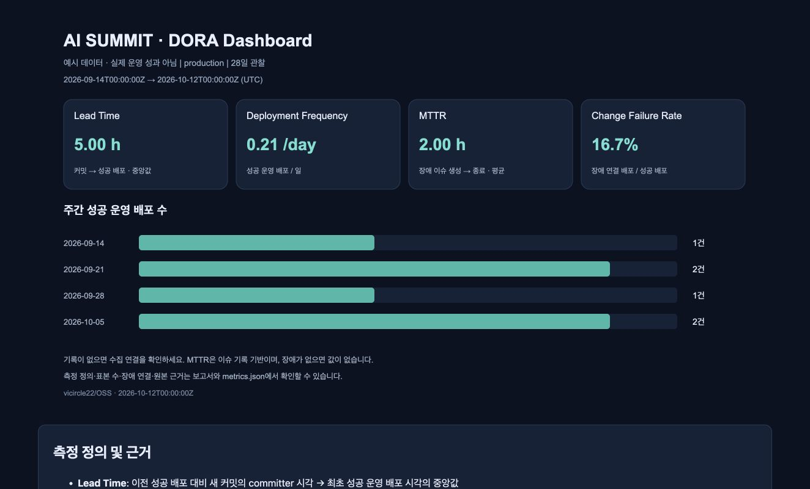

# OSS — AI SUMMIT

OSS 개발 과목 프로젝트 REPO

컴퓨터공학과 이승원, 컴퓨터공학과 이규호 공동 작업

## AI SUMMIT — 기획 산출물

AI 정보 저장·구조화 요약·Action Item 관리 서비스의 16주 MVP 설계입니다.

- [PRD](docs/AI-SUMMIT-PRD.md): 사용자·범위·요구사항·인수 조건·데이터 모델·API·16주 완료 기준
- [와이어프레임 화면 명세](docs/AI-SUMMIT-Wireframes.md): 네 화면, 모바일 배치, 상태·상호작용, 검토 시나리오
- [인터랙티브 와이어프레임](docs/wireframes/index.html): 설치나 외부 라이브러리 없이 브라우저에서 열기

`docs/wireframes/index.html`을 브라우저에서 열고 화면 선택·Desktop/Mobile·상태 예시로 검토할 수 있습니다. 일반 버튼으로도 검색·저장·편집·행동 완료·삭제 흐름을 확인할 수 있습니다. 예시 데이터만 사용하며 새로고침하면 초기화됩니다.

로컬 미리보기가 필요하면 Python이 설치된 환경에서 프로젝트 루트 기준으로 실행하세요.

```powershell
python -m http.server 8765 --bind 127.0.0.1 --directory docs
```

이후 `http://127.0.0.1:8765/wireframes/`를 엽니다. 이 명령은 로컬 검토용이며 배포 명령이 아닙니다.

원래 제안에 없던 로그인 범위·입력 제한·재분석 정책·평가 수치는 PRD에서 가정 또는 제안으로 구분했습니다. 실제 서비스 구현·LLM 연결·공개 배포는 포함되지 않습니다.

## 기존 자료

- [AI_SUMMIT](AI_SUMMIT): 기존 AI 관련 자료

## 2주차 — DORA 메트릭 수집 자동화

GitHub Actions로 **Lead Time, Deployment Frequency, MTTR, Change Failure Rate**를 수집한다. 최근 28일·주별 지표와 원본 근거를 주간 보고서로 생성하며 JSON·보고서·HTML/SVG 대시보드를 실행 아티팩트에 저장한다. 매주 월요일 09:00 KST에 자동 실행하고 배포 상태 및 장애 이슈 변경 시 갱신한다.

- [자동 수집 워크플로우](.github/workflows/metrics.yml)
- [Actions 실행 결과 및 주간 보고서](https://github.com/vicircle22/OSS/actions/workflows/metrics.yml)
- [수집 코드](scripts/dora/collect.py)
- [측정 정의·실행·배포/장애 연동·백업 복원 안내](docs/dora/README.md)
- [대시보드 HTML 시안](docs/dora/example/index.html) / [JSON 예시](docs/dora/example/metrics.json)

아래는 **예시 데이터로 만든 대시보드 시안**이다. 실제 운영 수치는 Actions 실행의 Summary와 `dora-metrics-*` 아티팩트에서 확인한다. 운영 배포 또는 장애 기록이 없으면 **데이터 없음**으로 표시한다.



[자동 생성 SVG 원본](docs/dora/example/dashboard.svg)

변경 전 저장소 스냅샷: [`backup-pre-dora-20261012-ebdd019`](https://github.com/vicircle22/OSS/tree/backup-pre-dora-20261012-ebdd019) (원래 커밋 `ebdd019`). 복원 절차는 위 안내에 포함되어 있다.
