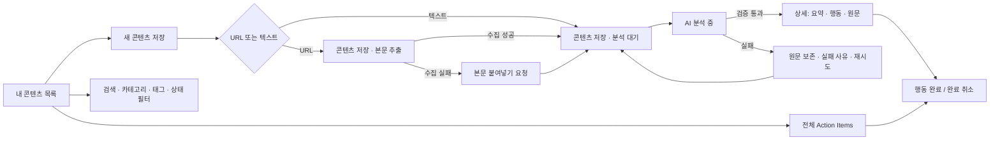
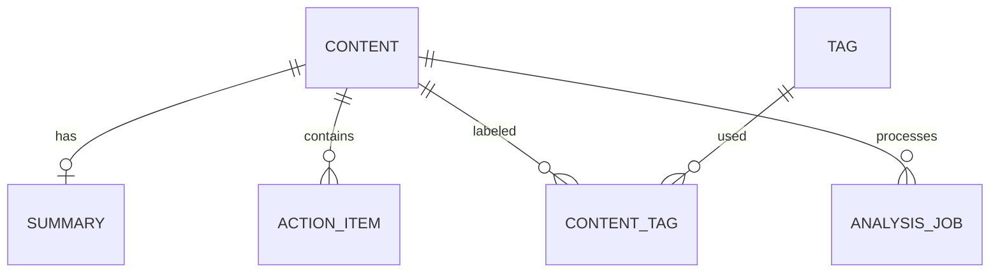
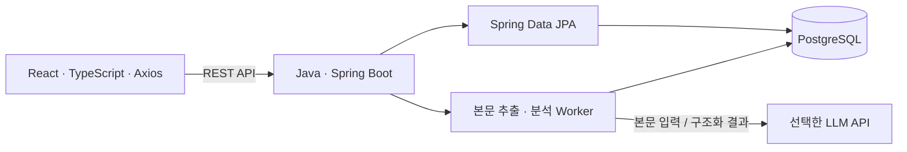

# AI Pocket — 제품 요구사항 문서 (PRD)

> AI 정보 저장 → 구조화 요약 → 핵심 이해 → Action Item 생성 → 실제 활용

| 항목 | 내용 |
| --- | --- |
| 버전 / 작성일 | v1.0 / 2026-10-01 |
| 문서 상태 | 개발 논의를 위한 초안. 아래 수치와 추가 정책은 제안이며 사용자 검증 전 가정이다. |
| 프로젝트 | AI Pocket — AI 정보 요약 및 실행 관리 서비스 |
| 일정 | 16주 학기 프로젝트. 실제 시작일이 정해지지 않아 주차로 표시한다. |
| 연결 산출물 | [인터랙티브 와이어프레임](./wireframes/index.html), [화면 및 상태 명세](./AI-Pocket-Wireframes.md) |

## 1. 제품 개요

AI Pocket은 여러 플랫폼에서 발견한 AI 관련 링크와 텍스트를 개인 저장소에 모으고, 내용을 이해하는 데 필요한 구조화 요약과 실행 가능한 Action Item을 제공하는 웹 서비스다. 사용자는 콘텐츠를 읽은 뒤 무엇을 할지 결정하고, 완료 여부를 기록한다.

**문제**

- Instagram, Threads, 블로그, 뉴스, 개발 커뮤니티에 저장한 정보가 흩어져 재탐색이 어렵다.
- 저장량이 늘수록 긴 원문을 다시 읽고 핵심과 중요성을 판단하는 시간이 늘어난다.
- 정보 저장이 학습·도구 실험·개발 적용으로 이어지지 않는다.

**가치 제안**: “발견한 AI 정보를 모으고, 이해하고, 실행한다.”

**핵심 원칙**: 원문과 AI 해석을 구분한다. 저장 성공과 분석 성공을 구분한다. AI 처리 실패로 이미 저장된 콘텐츠나 완료한 행동을 잃지 않는다.

## 2. 사용자와 사용 시나리오

다음은 검증이 필요한 가설 사용자이며 실제 인터뷰 결과가 아니다.

| 사용자 | 목적 | 현재 불편 | 핵심 사용 시나리오 |
| --- | --- | --- | --- |
| AI 개발을 학습하는 대학생 | 수업·개인 프로젝트에 적용할 자료 정리 | SNS 저장함을 다시 확인하지 않음 | AI 도구 게시물을 저장하고 설치·테스트 행동을 수행 |
| 새로운 AI 도구를 탐색하는 개발자 | 기술 변화와 적용 가능성 파악 | 긴 자료를 읽고 비교하는 데 시간 소요 | 개발 글을 요약하고 관련 기술·키워드로 재탐색 |

**JTBD**: “유용한 AI 자료를 발견했을 때, 핵심과 다음 행동을 빠르게 정리해서 나중에 실제 프로젝트에 적용하고 싶다.”

대표 시나리오:

1. 사용자가 AI 개발 도구 소개 URL을 등록한다.
2. 시스템이 콘텐츠를 먼저 저장한 뒤, 접근 가능한 본문을 추출한다.
3. AI가 핵심 내용·중요한 이유·관련 기술·키워드와 행동을 생성한다.
4. 사용자가 원문과 요약을 확인하고 필요하지 않은 행동을 삭제하거나 수정한다.
5. 공식 문서 확인, 환경 설치, 샘플 실행 등을 수행한 뒤 완료를 체크한다.
6. 검색·태그로 자료를 다시 찾아 적용 내용을 확인한다.

## 3. 목표, 검증 계획과 범위

### 3.1 제품 성공 기준 — 제안 목표

운영 실적이 아닌 학기 말 평가 기준이다. 먼저 5명 내외의 잠재 사용자로 검증하고 목표를 조정한다.

| 지표 | 정의 / 측정 방법 | 제안 기준 |
| --- | --- | --- |
| 핵심 흐름 수행 | 자료 등록 → 요약 확인 → 행동 1개 완료를 도움 없이 수행한 참여자 / 전체 참여자 | 5명 중 4명 이상 |
| 요약 이해도 | 읽은 요약의 핵심·중요성을 설명하고 5점 척도로 유용성을 평가 | 평균 4/5 이상 |
| 행동 실용성 | 생성 행동이 구체적이고 실제 수행 가능한지 수동 평가. 정보성 글의 빈 행동 목록은 별도 집계 | 평가 행동의 80% 이상 적합 |
| 분석 성공률 | 지원 본문이 있는 콘텐츠의 성공한 최초 분석 작업 / 최초 분석 작업 전체 | 20개 테스트 자료 중 18개 이상. 실패 원인 별도 기록 |
| 재탐색 성공 | 지정한 콘텐츠를 검색·필터로 30초 안에 찾은 참여자 비율 | 80% 이상 |

실제 사용 지표로 등록 수, 분석 성공·실패 수, 행동 생성 수, 완료 수를 최소한 기록한다. 완료 비율의 분모는 삭제되지 않은 행동이며, 완료 체크가 학습 성과를 입증하지는 않는다. 사용자 본문·요약은 이벤트 로그에 기록하지 않는다.

### 3.2 우선순위

| 범위 | 항목 |
| --- | --- |
| P0 — 16주 MVP 필수 | URL/텍스트 등록, 목록·상세·수정·삭제, 본문 수집 실패 시 붙여넣기, 구조화 요약, 자동 태그, Action Item 생성·수정·삭제·완료·완료 취소, 검색·필터, 분석 상태·재시도, 반응형 화면, 비공개 데모 배포 |
| P1 — 핵심 흐름 검증 후 | 회원가입/로그인과 개인별 저장소, 마감일·우선순위, 사용자 지정 카테고리, 즐겨찾기·보관, 요약 버전 이력, 개인화 행동 추천 |
| 이번 프로젝트 제외 | SNS 계정 동기화, 로그인·유료벽 우회 수집, 브라우저 확장, 모바일 네이티브 앱, 팀 공유, 콘텐츠 추천 피드, 영상·음성 전사, 설치·명령 실행 자동화, 알림·캘린더 연동 |

**범위 가정**: 기본안은 단일 사용자 개인 저장소와 접근을 제한한 데모다. 공개 다중 사용자 서비스가 필요하면 인증·소유권 검증을 P0로 올리고 일정을 재조정한다. 와이어프레임의 모든 자료와 AI 결과는 설명용 예시이며 실제 분석 결과가 아니다.

## 4. 정보 구조와 사용자 흐름



| 화면 ID | 화면 | 핵심 질문 / 핵심 행동 |
| --- | --- | --- |
| WF-01 | 내 콘텐츠 | 무엇을 저장했는가? 검색·필터·상세 열기 |
| WF-02 | 콘텐츠 저장 | 어떤 자료를 저장할 것인가? URL/텍스트 입력 |
| WF-03 | 콘텐츠 상세 | 핵심과 다음 행동은 무엇인가? 요약·Action Items·원문 탭 |
| WF-04 | 전체 Action Items | 아직 할 일은 무엇인가? 완료 상태 필터·체크·원문 연결 |

별도 대시보드 없이 목록이 기본 진입 화면이다. 사용자 목적과 관련 없는 통계·추천 화면은 추가하지 않는다.

## 5. 기능 요구사항 및 인수 조건

### F-01. 콘텐츠 등록 — P0

**입력**

| 필드 | 필수 여부 | 제안 제약 |
| --- | --- | --- |
| 입력 방식 | 필수 | URL / 텍스트 |
| 원문 URL | URL 방식 필수, 텍스트 방식 선택 | 공개 http/https URL, 최대 2,048자 |
| 본문 | 텍스트 방식 필수, URL 방식 선택 | 공백 제거 후 100~20,000자. 초과 시 잘라 저장하지 않고 안내 |
| 제목 | 선택 | 최대 120자. 비어 있으면 수집 제목 → 본문 첫 줄 → 출처 기반 임시 제목 순서로 결정 |
| 카테고리 | 필수 / 기본값 제공 | 전체 필터와 별개로 ‘미분류’, ‘AI 도구’, ‘모델·연구’, ‘개발·활용’, ‘뉴스·트렌드’ |
| 태그 | 선택 | 최대 5개, 각 20자, 공백·중복 정리. 사용자 태그는 자동 생성 시 보존 |
| 출처 | 자동 또는 선택 | URL 도메인에서 추론. URL 없는 텍스트는 ‘직접 입력’ |

- 저장 응답은 분석 완료를 기다리지 않는다. 저장 성공 시 상세 화면으로 이동해 처리 상태를 표시한다.
- 사용자가 URL과 본문을 함께 제공하면 붙여넣은 본문을 분석 입력으로 사용한다.
- URL 수집 지원 범위는 공개 HTML 텍스트다. Instagram/Threads 등 로그인이나 동적 렌더링이 필요한 자료는 링크 보관과 본문 붙여넣기로 처리한다. 자동 수집을 보장하지 않는다.
- 정규화한 URL이 이미 있으면 기존 콘텐츠로 이동하도록 안내한다. MVP에서는 동일 URL을 중복 저장하지 않는다. fragment와 기본 포트는 제거하고, 의미를 바꿀 수 있는 쿼리 파라미터는 유지한다.
- 링크만 있어도 콘텐츠를 보관하며, 본문이 없으면 AI 분석을 시작하지 않는다.

**인수 조건**

1. 정상 텍스트를 등록하면 목록·상세에 동일한 원문과 날짜가 보이며, 분석이 실패해도 유지된다.
2. 유효하지 않은 URL, 너무 짧거나 긴 본문은 해당 필드 옆에 오류를 표시하고 입력을 유지한다.
3. 중복 URL은 기존 제목과 이동 버튼을 보여주며 새 레코드를 생성하지 않는다.
4. 수집 실패 시 ‘본문 입력 필요’를 표시하고 본문 보완 후 분석을 진행할 수 있다.
5. 저장 중 버튼을 비활성화하고 중복 요청을 막는다. 서버 오류 시 재입력 없이 다시 저장할 수 있다.

### F-02. 콘텐츠 관리·탐색 — P0

- 목록에 제목, 출처, 등록일, 카테고리, 태그, 분석 상태와 행동 완료 수를 표시한다. 기본 정렬은 최근 등록순이다.
- 제목·본문·요약·태그를 검색한다. 카테고리·분석 상태·태그 필터는 검색과 AND 조건으로 적용한다. MVP 태그 필터는 단일 선택이다.
- 필터 결과 없음과 저장된 콘텐츠 없음은 다른 문구와 행동을 제공한다.
- 20개 단위 페이지 탐색을 제공한다. 페이지 크기는 구현 검증 후 조정 가능하다.
- 상세에서 제목·URL·카테고리·사용자 태그·본문을 수정한다. URL 변경은 중복 검사와 출처 갱신을 적용하며 기존 본문을 자동 교체하지 않는다. 재수집 기능은 후속 범위다.
- 본문 수정 시 기존 분석 결과를 ‘이전 본문 기준’으로 표시한다. 재분석 성공 전까지 이전 결과를 보존한다. 제목·카테고리·태그만 수정하면 AI 재분석은 하지 않는다.
- 콘텐츠 삭제 시 관련 요약·태그 연결·행동도 삭제됨을 확인 창에서 설명한다. 확인 후 삭제하고 목록으로 돌아간다.

**인수 조건**: 검색과 필터 조합의 결과가 데이터와 일치한다. 초기화 시 전체 목록으로 복귀한다. 편집 내용은 새로고침 후 유지된다. 삭제 취소는 데이터를 바꾸지 않는다. 처리 중 삭제된 자료는 이후 작업 결과로 다시 생성되지 않는다.

### F-03. AI 구조화 요약 — P0

| 결과 필드 | 사용자에게 전달할 내용 | 제안 규칙 |
| --- | --- | --- |
| 한 줄 요약 | 자료의 주제를 빠르게 파악 | 1~2문장 |
| 핵심 내용 | 무엇이 달라졌고 무엇을 다루는가 | 1~5개 bullet, 불필요한 반복 금지 |
| 중요한 이유 | 어떤 학습·개발 맥락에서 유용한가 | 1~3문장, 원문 사실과 활용 해석 구분 |
| 관련 기술 | 원문에 등장하는 도구·모델·기술 | 최대 5개. 근거 없으면 빈 배열 |
| 주요 키워드 | 재탐색을 돕는 용어 | 최대 5개 |
| Action Items | 구체적으로 수행할 다음 행동 | F-04 규칙 적용 |

- 한국어 결과를 기본으로 하되 기술·제품 고유명사는 보존한다.
- 제공된 본문만 근거로 사용한다. 외부 검색이나 사실 검증을 수행했다고 표시하지 않는다.
- 결과에 ‘AI가 생성한 요약’과 원문 확인 링크 또는 원문 탭을 제공한다. 중요성은 AI의 활용 해석임을 표시한다.
- 구조화 JSON을 서버에서 검증한 후 요약과 행동을 하나의 트랜잭션으로 저장한다. 잘못된 응답을 정상 결과로 표시하지 않는다.
- 자동 생성 태그는 최대 5개이며 사용자 태그를 먼저 유지하고 남은 자리만 채운다. 삭제·수정할 수 있다.
- 불충분한 본문에는 내용을 만들어내지 않고 본문 보완을 요청한다.
- 재분석 확인 시 이전 행동 교체 여부를 설명한다. MVP는 미완료 행동을 새 제안으로 교체하고 완료 행동은 보존한다. 수정한 미완료 행동도 교체되므로 명시적으로 안내한다. 실패하면 이전 요약·행동 모두 유지한다.

**인수 조건**: 고정 평가 자료 20개에 대해 필드 형식, 핵심 일치, 허위 기술·링크 여부를 검사한다. 관련 기술이나 행동이 없는 경우 빈 목록을 정상 처리한다. 누락 필드·JSON 오류는 실패 상태와 재시도 안내로 이어진다. 완료 행동은 재분석 성공 후에도 유지된다.

### F-04. Action Item 생성·관리 — P0

- 콘텐츠마다 0~5개 행동을 생성한다. 실행 가능한 행동이 없으면 빈 목록과 이유를 제공한다.
- 제목은 동사로 시작하고, 설명에는 실행 대상과 완료 기준을 포함한다. 예: “예제 요청을 실행하고 입력·응답을 기록한다.”
- 링크는 본문 또는 원문 URL에 존재하는 링크만 사용한다. 근거 없는 공식 문서 주소를 생성하지 않는다.
- 각 행동은 콘텐츠 ID와 연결되고 ‘미완료 / 완료’ 및 완료 시각을 가진다. 생성 직후 모두 미완료다.
- 상세 화면과 전체 행동 화면에서 완료·완료 취소가 가능하다. 두 화면과 목록 진행률은 동일한 데이터를 사용한다.
- 사용자는 행동 제목·설명을 수정하거나 불필요한 행동을 삭제할 수 있다. 수동 새 행동 추가는 P1이다.
- 완료 저장 실패 시 체크를 이전 상태로 복구하고 재시도 메시지를 표시한다.

**인수 조건**: 3개 행동 중 1개를 체크하면 상세·전체 행동·목록 모두 1/3으로 표시한다. 완료 취소는 completedAt을 제거한다. 마지막 행동 삭제 시 ‘행동 없음’을 표시하며 0으로 나누지 않는다. 체크 UI는 실제 저장 성공을 확인한 후 유지한다.

### F-05. 비동기 처리와 복구 — P0

| 상태 | 의미 | 사용자에게 제공할 행동 |
| --- | --- | --- |
| EXTRACTING | URL의 본문 수집 중 | 저장 사실 확인, 목록 이동 |
| NEEDS_TEXT | 수집 실패 또는 내용 부족 | 본문 붙여넣기 |
| QUEUED | AI 작업 대기 중 | 대기 안내 |
| ANALYZING | 구조화 요약·행동 생성 중 | 진행 안내, 원문 확인 |
| READY | 검증된 분석 결과 저장 완료 | 요약 읽기, 행동 관리 |
| FAILED | API·시간 초과·응답 검증 실패 | 입력 보존, 원인 요약, 수동 재시도 |

기존 결과의 최신 여부는 위 상태와 별도의 `analysisStale`로 표시한다. 재분석 중·실패 시 이전 결과를 계속 볼 수 있다.

- 동일 콘텐츠에 동시에 실행 중인 분석은 하나로 제한한다. 중복 요청은 같은 작업 ID를 반환한다.
- 제안 타임아웃은 추출 10초, LLM 요청 60초다. 일시적 429/5xx는 최대 1회 자동 재시도하고, 이후 수동 재시도를 제공한다. 확정 값은 실제 API 테스트 후 조정한다.
- API 키 오류·쿼터 초과는 사용자에게 일반 메시지를 보이고 서버에 원인 코드를 기록한다. API 키·원문은 오류 로그에서 제외한다.
- 서버 재시작 시 일정 시간 갱신되지 않은 진행 작업을 FAILED로 복구하고 다시 시도할 수 있게 한다. MVP는 DB 작업 테이블과 Spring worker로 처리하며 별도 메시지 큐는 필요 시 도입한다.

## 6. 비기능 요구사항

| 영역 | 요구사항 / 검증 기준 |
| --- | --- |
| 성능 | 테스트 환경과 데이터 규모를 기록한다. 1,000개 콘텐츠 기준 목록·검색 API p95 1초 이내, 저장 API p95 2초 이내를 제안 목표로 삼는다. AI 시간은 별도로 측정한다. |
| 접근성 | 폼 label 연결, 키보드 이동, 보이는 포커스, 상태를 글자로 표시, 체크 상태 스크린리더 전달. 오류·처리 결과는 live region으로 안내한다. |
| 반응형 | 390px 모바일과 1,280px 데스크톱에서 핵심 작업 가능. 모바일은 목록 카드와 하단 탐색, 상세는 한 열 배치. |
| 데이터 일관성 | 요약·행동 저장 트랜잭션, FK 제약, 완료 변경 멱등성, URL 중복 제약, 본문 버전이 달라진 작업 결과 반영 차단. |
| AI 보안 | 본문은 분석 대상 데이터로 취급해 지시문을 실행하지 않는다. 결과 HTML은 렌더링하지 않고 텍스트로 표시한다. LLM은 설치·네트워크·파일 작업을 실행하지 않는다. |
| URL 수집 보안 | 서버가 사설·loopback·link-local IP와 비 http/https 스킴을 차단한다. DNS 및 매 리다이렉트 목적지를 재검사하고 응답 크기·시간을 제한한다. |
| 키·배포 | LLM 키는 Backend 환경변수에만 저장한다. 저장소·프론트엔드·로그에 포함하지 않는다. CORS는 승인된 Frontend origin으로 제한하고 배포는 HTTPS를 사용한다. |
| 개인정보 | 등록 화면에서 입력 본문이 요약 생성을 위해 외부 AI 제공자에게 전달됨을 안내한다. 민감정보 입력을 피하도록 안내하며 삭제 시 서비스의 관련 레코드를 제거한다. 제공자 보존 정책은 선택 후 확인한다. |
| 비용 | 분석 요청당 길이 제한, 중복 작업 차단, 호출량·토큰량 기록. 구체적인 월 예산과 제공자 모델은 8주차 전에 결정한다. |
| 관측성 | 작업 ID, 상태 전이, 지연, 실패 코드, 호출 횟수를 기록한다. 운영 화면 추가 없이 서버 로그로 MVP 점검한다. |

## 7. 데이터 모델 초안

| 엔티티 | 주요 필드 | 관계 / 제약 |
| --- | --- | --- |
| Content | id, inputType, title, sourceUrl, normalizedUrl, source, body, bodyVersion, category, status, analysisStale, errorCode, createdAt, updatedAt | URL은 nullable unique. 본문 버전은 변경할 때 증가. 단일 사용자 MVP 기준 |
| Summary | id, contentId, bodyVersion, headline, keyPoints(JSONB), importance, technologies(JSONB), keywords(JSONB), noActionReason, provider, model, promptVersion, generatedAt | Content 1:0..1 현재 요약. 모든 결과는 동일 본문 버전 기준 |
| ActionItem | id, contentId, title, description, referenceUrl, origin, isCompleted, completedAt, createdAt, updatedAt | Content 1:N. 완료 취소 시 completedAt=null |
| Tag | id, name | 정규화된 name unique |
| ContentTag | contentId, tagId, origin | N:M. 복합 unique. origin=USER/AI, 자동 결과가 사용자 태그를 덮어쓰지 않음 |
| AnalysisJob | id, contentId, bodyVersion, status, attempt, provider, startedAt, finishedAt, updatedAt, errorCode | Content 1:N. 동일 콘텐츠 진행 작업 하나, 삭제된 콘텐츠에 결과 저장 금지 |



로그인을 추가하면 모든 Content에 ownerId를 도입하고 목록·상세·행동·작업 API에서 소유권을 검사한다. 현재 모델은 인증 없는 공개 운영의 설계가 아니다.

## 8. REST API 초안

버전 prefix: `/api/v1`. 요청·응답은 JSON, 날짜는 ISO 8601 UTC, UI 표시는 Asia/Seoul 기준. 실제 DTO/오류 코드는 3주차에 확정한다.

| Method / Endpoint | 목적 | 핵심 동작 |
| --- | --- | --- |
| POST /contents | 자료 저장 | inputType, title?, sourceUrl?, body?, category, tags. 저장 후 201 + id/status/jobId? |
| GET /contents | 목록·검색 | q, category, tag, status, page, size, sort. items/total/page/size |
| GET /contents/{id} | 상세 | 원문, 요약, 행동, 분석 상태·최신 여부 |
| PATCH /contents/{id} | 수정 | 허용 필드만 변경. body 변경 시 버전 증가·stale 설정 |
| DELETE /contents/{id} | 삭제 | 관련 결과·행동·작업 연결 삭제, 204 |
| POST /contents/{id}/analysis | 분석·재시도 | 202 + jobId. 본문 필요 시 422. 기존 진행 작업이면 동일 jobId |
| GET /analysis-jobs/{jobId} | 진행 조회 | status/errorCode. 초기 2초 간격 polling, terminal 상태에서 중지 |
| GET /action-items | 전체 행동 | completed?, contentId?, page, size. 원본 제목 포함 |
| PATCH /action-items/{id} | 편집·완료 처리 | title?, description?, isCompleted?. 서버가 completedAt 결정 |
| DELETE /action-items/{id} | 불필요 행동 제거 | 204. 진행 수 재계산 |
| GET /tags | 태그 필터 목록 | name/count. 삭제된 콘텐츠 제외 |

공통 오류 형태: `{ "code": "DUPLICATE_URL", "message": "이미 저장된 링크입니다.", "fieldErrors": {}, "existingContentId": "..." }`. 400 입력 오류, 404 없는 자료, 409 URL 중복·본문 버전 충돌, 422 분석 입력 부족, 429 사용량 제한, 500 저장 오류. 내부 공급자 메시지는 그대로 노출하지 않는다.

제안 LLM 응답 계약:

```json
{
  "headline": "자료의 한 줄 요약",
  "keyPoints": ["핵심 내용"],
  "importance": "어떤 맥락에서 유용한지에 대한 해석",
  "technologies": ["원문에 등장한 기술"],
  "keywords": ["재탐색 키워드"],
  "suggestedTags": ["개발"],
  "actionItems": [
    {
      "title": "샘플 요청을 실행한다",
      "description": "본문에 제시된 예제를 실행하고 입력·출력 결과를 기록하면 완료",
      "referenceUrl": null
    }
  ],
  "noActionReason": null
}
```

API 요청·외부 LLM 응답·화면 표시 모델을 분리한다. LLM이 반환한 콘텐츠 ID나 완료 상태는 신뢰하지 않고 서버가 결정한다.

## 9. 기술 구조와 선택 사항



- Frontend: React, TypeScript, HTML, CSS, Axios. 저장·검색·상태·오류 UI를 담당한다.
- Backend: Java, Spring Boot, Spring Data JPA, REST API. 영속화, 공개 본문 추출, LLM 호출·응답 검증을 담당한다.
- Database: PostgreSQL. 구조화 결과는 JSONB, 핵심 관계는 정규화 테이블로 관리한다.
- AI: OpenAI 또는 Gemini 중 하나로 시작한다. 출력 형식 안정성, 한국어 평가 결과, 비용·쿼터, 개인정보 정책을 비교해 8주차 전 확정한다.
- Deployment: 제안 기본안은 Vercel Frontend + Render Backend/PostgreSQL이며, 비용과 비공개 접근 방식 확인 후 선택한다. AWS는 대안이다. 가격·현재 지원 사양은 본 문서에서 확정하지 않는다.
- 도구: Git, GitHub, IntelliJ IDEA, VS Code, Postman. API 계약과 배포 방법을 README에 기록한다.

## 10. 16주 마일스톤과 주차별 완료 기준

원래 일정은 유지하고 각 주차에 확인 가능한 결과를 추가했다. 테스트는 구현 주차부터 수행하고 15주차에는 통합 검증에 집중한다.

| 주차 | 작업 | 완료 기준 / 산출물 |
| --- | --- | --- |
| 1 | 주제 확정, Git/GitHub 환경, 제안서 | 저장소·브랜치 규칙·실행 안내·프로젝트 제안서 |
| 2 | 요구사항 구체화 | PRD·와이어프레임 검토, P0/P1 합의, 사용자 흐름 검증 |
| 3 | 시스템 설계·ERD | ERD, API 계약, 상태 전이, 분석 응답 계약 확정 |
| 4 | Spring Boot·DB 연결 | 로컬 실행·DB migration·기본 health 확인 |
| 5 | 콘텐츠 CRUD | URL/텍스트 저장·조회·수정·삭제·중복 검사 API 검증 |
| 6 | React 기본 화면 | 목록·등록·상세·행동 화면과 모바일 배치 |
| 7 | Frontend/Backend 연동 | 브라우저에서 CRUD 왕복, 저장 실패·빈 목록 처리 |
| 8 | LLM API·기본 요약 | 제공자 결정, 서버 키 관리, 분석 대기·실패·재시도 |
| 9 | 구조화 요약 | 필드 검증, 불충분 본문 처리, 평가 자료 수동 검수 |
| 10 | 자동 태그·키워드 | 자동 결과와 사용자 태그 병합·수정 검증 |
| 11 | Action Item 생성 | 구체적인 행동 0~5개 생성, 빈 행동 설명 |
| 12 | 행동 관리 | 완료·취소·편집·삭제, 두 화면 진행 수 일치 |
| 13 | 검색·필터 | 검색·카테고리·태그·상태 조합과 페이지 탐색 검증 |
| 14 | UI·예외 처리 | 모바일·키보드·수집 실패·시간 초과·stale·삭제 경쟁 검증 |
| 15 | 통합 테스트·배포 | 핵심 흐름 통과, 오류 복구, 비공개 배포·환경 설정 |
| 16 | 결과 정리·README·발표 | 데모 영상/화면, 평가 결과, 한계·후속 계획, 최종 발표 |

위험 대응: 일정 지연 시 P1을 제외하고, URL 자동 수집 지원을 공개 정적 HTML로 제한한다. 텍스트 저장 → 요약 → 행동 완료 흐름은 반드시 유지한다. 주차는 실제 팀 규모와 착수일 확정 후 재조정한다.

## 11. 출시 검수 체크리스트

- [ ] 정상 텍스트로 저장 → 구조화 요약 → 행동 생성 → 완료까지 동작한다.
- [ ] 수집 불가능 URL이 보관되고 본문 보완으로 복구된다.
- [ ] 중복 URL과 필드 오류가 입력 유실 없이 처리된다.
- [ ] AI 타임아웃·쿼터·잘못된 JSON이 실패 상태로 이어지고 재시도된다.
- [ ] 본문 편집 후 기존 결과가 stale로 표시되며 오래된 작업이 새 본문에 반영되지 않는다.
- [ ] 재분석은 완료 행동을 보존하며 실패 시 이전 요약·행동을 보존한다.
- [ ] 행동 체크·취소·편집·삭제와 전체 진행 수가 일치한다.
- [ ] 검색·필터·결과 없음·전체 빈 목록이 구분된다.
- [ ] 콘텐츠 삭제 중 진행 중인 분석이 콘텐츠를 복구하지 않는다.
- [ ] 390px/1,280px, 키보드 탐색, label, 상태 안내가 확인된다.
- [ ] LLM 키가 Git·브라우저에 없고 URL 수집 제한이 검증된다.
- [ ] 실제 LLM 평가 자료 20개, 사용자 검증 결과와 실패 원인을 기록한다.
- [ ] 비공개 배포와 README 실행·환경변수·기술 선택 안내를 완료한다.

## 12. 아직 결정되지 않은 사항

이 항목은 초안의 의사결정 목록이며 산출물 작성의 선행 조건은 아니다.

| 결정 사항 | 현재 가정 | 결정 시점 |
| --- | --- | --- |
| 팀 규모·시작일 | 학기 프로젝트, 인원·날짜 미정 | 착수 시 |
| 로그인 / 공개 배포 | 단일 사용자·비공개 데모 | 2주차. 공개 필요 시 인증을 P0로 이동 |
| LLM 제공자·모델·예산 | 제공자 1개, 모델 미정 | 8주차 전 |
| 콘텐츠 길이·타임아웃 | 본 문서의 제안 제한 | 실제 자료·API 평가 후 |
| 행동 재생성 정책 | 완료 유지 / 미완료 교체, 사전 안내 | 2주차 검토 |
| 카테고리 | 5개 고정, ‘미분류’ 기본 | 사용자 흐름 검증 후 |
| 수집 지원 사이트 | 공개 HTML 우선, SNS는 붙여넣기 | 5~8주차 실험 |

## 13. 산출물의 검증 범위

이 문서는 제품·개발 계획이며 실제 서비스나 API를 구현했다는 의미는 아니다. 연결된 와이어프레임은 예시 데이터로 화면 전환·검색·필터·저장·편집·체크·오류 상태를 검토하는 브라우저 프로토타입이다. 외부 수집·LLM 호출·DB 저장·배포는 수행하지 않는다. 화면상의 생성 결과와 대기 시간은 시뮬레이션이다.
