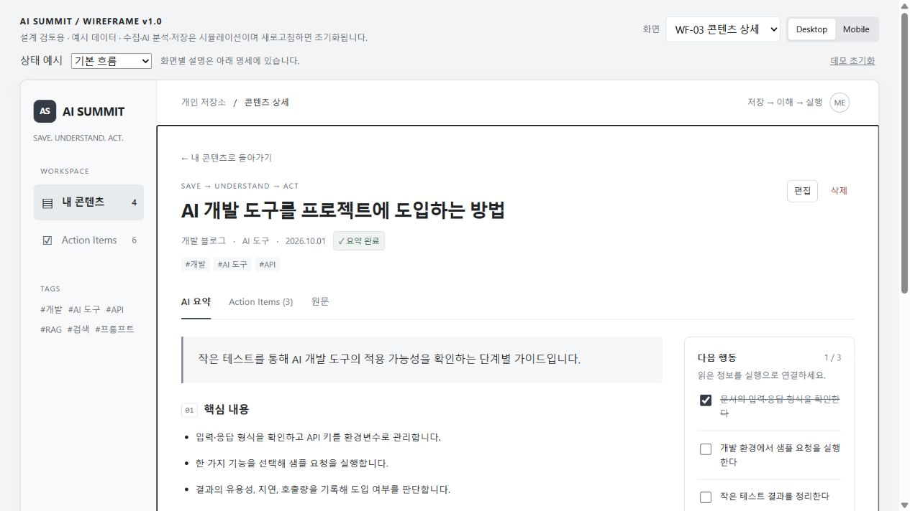

# AI SUMMIT — 와이어프레임 화면 명세

| 항목 | 내용 |
| --- | --- |
| 기준 | [PRD v1.0](./AI-SUMMIT-PRD.md), 2026-10-01 |
| 실행 파일 | [인터랙티브 와이어프레임](./wireframes/index.html) |
| 충실도 | 중간 충실도, 흑백 중심. 정보 위계와 상태·상호작용 검토용이며 최종 비주얼 디자인이 아니다. |
| 데이터 | 4개 가상 콘텐츠, 8개 행동(2개 완료 / 6개 미완료). 데모 초기화 시 복구. |
| 화면 | 내 콘텐츠, 콘텐츠 저장·편집, 상세의 세 탭, 전체 Action Items |
| 기기 | Desktop, Mobile(390px) 미리보기. 실제 화면 너비에 따라서도 반응형 적용. |

## 1. 공통 구조

프로토타입 상단의 화면 선택·Desktop/Mobile·상태 예시·초기화는 **검토 도구**다. 실제 서비스 UI에는 넣지 않는다. 검토 도구 아래부터 실제 서비스 화면이며, 맨 아래 WF 설명도 개발 검토용이다.

```text
데스크톱
┌────────────┬────────────────────────────────────────┐
│ AI SUMMIT  │ 개인 저장소 / 현재 화면                 │
│            ├────────────────────────────────────────┤
│ 내 콘텐츠  │ 화면 제목                     주요 행동 │
│ Action     │ 검색 / 필터 또는 화면별 작업 영역       │
│ Items      │                                        │
│            │ 목록 · 등록 폼 · 상세 · 행동 목록        │
│ 태그       │                                        │
│ 개인 저장소│                                        │
└────────────┴────────────────────────────────────────┘

모바일
┌────────────────────────┐
│ AI SUMMIT              │
├────────────────────────┤
│ 화면 제목 / 주요 행동  │
│ 한 열의 콘텐츠 영역    │
│ (세로 스크롤)          │
├────────────────────────┤
│ 내 콘텐츠 | 저장 | 행동│
└────────────────────────┘
```

탐색은 내 콘텐츠·전체 행동을 기본으로 한다. 콘텐츠 저장은 목록의 주요 버튼 또는 모바일 하단 탐색으로 진입한다. 상세의 ‘돌아가기’는 목록으로 이동하며 필터를 유지한다. 프로토타입의 날짜는 고정 예시다.

## 2. WF-01 — 내 콘텐츠

**사용자 목적**: 저장된 정보를 다시 찾고 처리 상태와 다음 행동을 확인한다.

| 영역 | 구성 | 동작 |
| --- | --- | --- |
| 제목 영역 | 내 콘텐츠, 한 줄 설명, ‘콘텐츠 저장’ | WF-02 진입 |
| 목록 요약 | 저장 수, 요약 완료 수, 본문 필요 수 | 현재 저장소 기준 집계. 성과 지표가 아님 |
| 검색·필터 | 텍스트 검색, 카테고리, 분석 상태, 단일 태그 | AND 조건, 초기화 제공 |
| 목록 행 | 제목, 출처, 카테고리, 태그, 상태, 행동 완료 수, 날짜 | 제목 클릭 시 WF-03 |
| 페이지 | 현재 페이지 / 총 페이지 | 데모는 4개 자료로 1페이지. 실제 MVP는 서버 페이지 탐색 |
| 빈 상태 | 자료 없음 / 검색 결과 없음 | 첫 저장 / 필터 초기화로 각각 연결 |

데스크톱에서는 비교하기 쉬운 행 배치를 사용한다. 모바일에서는 제목·메타·태그를 위쪽에 놓고 상태·완료 수를 아래에 배치한다. 날짜는 모바일에서 생략하며 상세에서 확인할 수 있다. 완료 수는 행동이 없을 때 ‘—’로 표시한다.

검색 대상은 제목·본문·요약·태그이며 예시 데이터에서 로컬로 필터링된다. 좌측 태그를 선택해도 동일한 필터 상태를 사용한다.

## 3. WF-02 — 콘텐츠 저장 / 편집

**사용자 목적**: 발견한 정보를 최소한의 입력으로 보관한다.

| 영역 | 구성 | 동작 |
| --- | --- | --- |
| 입력 방식 | URL로 저장 / 텍스트로 저장 | 전환해도 작성 중인 필드 값 유지 |
| 핵심 입력 | URL, 본문 | URL 방식은 URL 필수. 텍스트 방식은 본문 필수 |
| 추가 정보 | 제목, 카테고리, 태그 | 제목·태그 선택, 카테고리 ‘미분류’ 기본 |
| 사용 안내 | 저장 후 진행 흐름, 수집 실패 대응 | Instagram·Threads 자동 수집을 보장하지 않음 |
| AI 안내 | 외부 제공자 전송 안내 | 등록 전에 본문 전송 여부를 알 수 있음 |
| 버튼 | 취소 / 저장하고 요약하기 | 입력 검사 → 저장 → 상세 화면 |

- 본문 100~20,000자, URL 2,048자, 제목 120자, 태그 5개·각 20자 제한을 적용한다.
- 오류는 관련 필드 옆에 표시하고 입력값은 유지한다. 저장 실패는 폼 하단에 표시한다.
- 동일 URL은 기존 콘텐츠 제목과 이동 버튼을 제공한다.
- URL만 저장한 데모는 ‘수집 중 → 본문 입력 필요’로 전환한다. URL+본문 또는 텍스트 저장은 ‘대기 → 분석 중 → 요약 완료’로 전환한다.
- 편집 화면은 같은 폼을 재사용한다. 제목·카테고리·태그 편집은 분석에 영향을 주지 않고, 본문 변경은 기존 요약을 ‘이전 본문 기준’으로 표시한다.

## 4. WF-03 — 콘텐츠 상세

**사용자 목적**: 자료를 이해하고 다음 행동을 수행한다.

```text
┌─────────────────────────────────────────────────────────┐
│ ← 내 콘텐츠                                             │
│ 콘텐츠 제목                                편집 / 삭제  │
│ 출처 · 카테고리 · 등록일 · 분석 상태                     │
│ 태그                                                    │
│ [상태 메시지: 입력 필요 / 대기 / 실패 / 이전 본문 기준] │
├─────────────────────────────────────────────────────────┤
│ AI 요약 | Action Items | 원문                           │
├─────────────────────────────────┬───────────────────────┤
│ 한 줄 요약                      │ 다음 행동     1 / 3   │
│ 01 핵심 내용                    │ ☑ 문서 확인           │
│ 02 왜 중요한가요?               │ ☐ 샘플 요청           │
│ 03 관련 기술                    │ ☐ 결과 정리           │
│ 04 주요 키워드                  │ 행동 상세 보기 →      │
│ AI 생성 표시 / 원문 비교        │                       │
└─────────────────────────────────┴───────────────────────┘
```

### AI 요약 탭

한 줄 요약, 핵심 bullet, 중요한 이유, 관련 기술, 주요 키워드 순서로 읽는다. 중요성은 ‘AI의 활용 해석’으로 표시한다. 키워드는 목록 검색으로 이동하며 ‘원문과 비교하기’는 원문 탭을 연다. 다음 행동은 오른쪽 미리보기에서 바로 체크할 수 있다. 모바일에서는 요약 다음에 행동 미리보기를 놓는다.

### Action Items 탭

완료 수와 진행 막대, 행동 제목, 수행·완료 기준, AI 제안 표시, 체크, 수정·삭제를 제공한다. 완료 체크는 취소 가능하며 두 화면의 상태가 일치한다. 수정은 인라인 폼, 삭제는 확인 대화상자로 처리한다. 행동이 없으면 적절한 이유를 표시한다.

### 원문 탭

원문 URL을 새 탭에서 열거나 저장 본문을 확인한다. HTML은 텍스트로 표시한다. 본문 편집으로 WF-02 편집 폼에 이동한다. URL이 없는 직접 입력도 동일한 흐름을 사용한다.

### 상태와 재분석

| 상태 예시 | 표시 | 다음 행동 |
| --- | --- | --- |
| 본문 입력 필요 | 링크 저장 완료, 내용 부족 안내 | 편집 폼에서 본문 추가 |
| 분석 대기 / 분석 중 | 진행 문구, 결과 대기 영역 | 원문 확인 또는 목록 이동 |
| 분석 실패 | 입력 보존, 시간 초과 예시 문구 | 다시 분석 |
| 이전 본문 기준 | 기존 요약을 유지하고 경고 | 다시 분석 |
| 행동 없음 | 실행 행동을 찾지 못했다는 문구 | 요약·원문 확인 |

기존 미완료 행동이 있는 재분석은 확인 대화상자에서 ‘완료 행동 유지 / 수정한 미완료 행동도 교체 / 실패 시 기존 결과 유지’를 설명한다. 콘텐츠 삭제는 요약과 행동도 함께 삭제된다고 안내한다.

## 5. WF-04 — 전체 Action Items

**사용자 목적**: 어떤 콘텐츠에서 생성됐는지와 관계없이 할 일을 실행한다.

- 기본 필터는 미완료. 미완료 / 완료 / 전체에 개수를 표시한다.
- 행동 제목과 완료 기준, 원본 콘텐츠 링크, 체크·수정·삭제를 제공한다.
- 미완료 화면에서 체크하면 완료 목록으로 이동한다. 완료 화면에서 체크를 해제하면 되돌아간다.
- 원본 링크를 클릭하면 해당 상세의 Action Items 탭으로 이동한다.
- 별도 마감일·우선순위·수동 새 행동 추가는 MVP에 포함하지 않는다.

## 6. 프로토타입 검토 시나리오

1. **기본 흐름**: 목록 첫 자료 → 요약 → 행동 체크 → 전체 행동의 완료 탭에서 확인 → 체크 해제.
2. **검색**: ‘RAG’를 검색 → 카테고리 ‘개발·활용’ → 태그 ‘개발’ → 초기화.
3. **텍스트 저장**: 저장 → 텍스트 선택 → 100자 이상 본문 → 저장 → 대기·분석·요약·행동 확인.
4. **수집 실패 복구**: Threads 예시 또는 ‘본문 입력 필요’ 선택 → 본문 붙여넣기 → 저장 → 분석 확인.
5. **폼 오류**: 짧은 본문 / 잘못된 URL / 태그 6개 → 필드 오류와 입력 보존 확인.
6. **중복**: `https://example.com/ai-tool-guide`를 저장 → 기존 콘텐츠 이동 확인.
7. **저장 실패**: 상태 예시 ‘저장 오류 체험’ → 유효 입력 후 첫 저장 실패 → 같은 입력으로 재시도 성공.
8. **재분석**: ‘이전 본문 기준’ → 다시 분석 → 미완료 교체 안내 → 완료 행동 유지 확인.
9. **수정·삭제**: 행동 제목·기준 수정, 행동 삭제 취소/확인, 콘텐츠 삭제 취소/확인.
10. **모바일**: Mobile로 전환해 네 화면과 본문 입력·행동 체크를 확인한다.

상태 예시의 대기·분석 중 화면은 검토하기 위해 정지된 상태다. 실제 시간 경과 시뮬레이션은 등록·재시도 흐름에서 확인한다. ‘데모 초기화’는 기존 예시 데이터를 복구한다.

## 7. 구현과 검증의 경계

이 프로토타입은 브라우저 메모리에서만 동작한다. 페이지 새로고침 시 수정 데이터가 초기화되며, 외부 URL 수집·LLM 호출·영속화·인증·배포·서버 오류 복구·실제 페이지 탐색은 구현하지 않았다. 요약 생성은 입력의 의미를 분석하지 않고 명시적인 데모 결과를 표시한다. 해당 기능의 실제 요구사항은 PRD를 따른다.

인수 테스트와 브라우저 프로토타입 검토는 서로 다르다. 실제 Backend가 구현되면 저장 실패 시 행동 체크 복구, URL 수집 제한, 재시작 복구, 데이터 소유권, 비동기 경쟁과 LLM JSON 검증을 별도로 테스트해야 한다.

## 8. 정적 화면 미리보기

브라우저 프로토타입과 동일한 예시 화면을 캡처했다. 화면 명세와 함께 발표·개발 검토에 사용할 수 있다.

| 화면 | 미리보기 |
| --- | --- |
| WF-01 내 콘텐츠 | [데스크톱 이미지](./wireframes/previews/wf-01-desktop.jpg) |
| WF-02 콘텐츠 저장 | [데스크톱 이미지](./wireframes/previews/wf-02-desktop.jpg) |
| WF-03 콘텐츠 상세 | [데스크톱 이미지](./wireframes/previews/wf-03-desktop.jpg), [모바일 배치 이미지](./wireframes/previews/wf-03-mobile.jpg) |
| WF-04 전체 행동 | [데스크톱 이미지](./wireframes/previews/wf-04-desktop.jpg) |



## 9. 프로토타입 확인 결과

2026-10-01, 로컬 브라우저에서 다음을 확인했다. 이는 예시 데이터의 UI 검증이며 실제 서비스 출시 검수 결과가 아니다.

| 검토 항목 | 확인 결과 |
| --- | --- |
| 검색·카테고리 조합·초기화 | RAG 검색·카테고리 적용 시 1개, 초기화 시 4개 |
| 행동 완료·취소·동기화 | 상세 2/3 → 전체 미완료 5·완료 3 → 취소 시 미완료 6·완료 2 |
| URL·본문 입력 검사·중복 | 잘못된 URL·짧은 본문 오류, 중복 URL의 기존 콘텐츠 안내 |
| 텍스트 등록 | 저장 후 상세 이동, 예시 요약·행동 생성 |
| URL 단독 등록 | 링크 보관 후 본문 입력 필요로 전환 |
| 본문 보완·편집 | 본문 추가 후 분석, 기존 본문 편집 후 stale 안내 |
| 재분석·오류 복구 | 교체 정책 안내, 완료 행동 유지, 분석 실패 재시도 |
| 저장 오류 | 입력 유지, 같은 내용으로 두 번째 저장 성공 |
| 수정·삭제 | 행동 수정, 행동 삭제 취소·확인, 콘텐츠와 연결 행동 삭제 |
| 빈 상태 | 빈 저장소·검색 결과 없음·행동 없음·대기·분석 중·실패 문구 |
| 키보드 | 상세 탭에서 ArrowRight로 다음 탭 선택 |
| 모바일 | 390px에서 네 화면 가로 넘침 없음, 행동 완료 체크 |
| 데스크톱 | 1,280px에서 목록 가로 넘침 없음 |
| 런타임 | JavaScript 구문 검사 통과, 확인 시 브라우저 error 로그 없음 |

모바일 정적 이미지는 데스크톱에서 390px 제품 프레임을 선택한 미리보기다. 실제 브라우저 390px 검토는 화면 구조·가로 넘침·행동 체크로 별도 확인했다.
