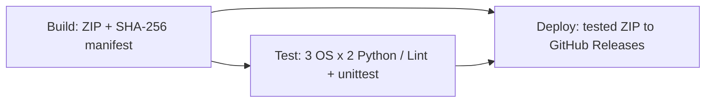

# 7주차 · GitHub Actions 기반 기본 CI/CD

작성일: 2026-11-10 (Asia/Seoul). Python 프로젝트의 패키지 빌드·Lint·Test·다운로드 배포를 자동화합니다.

## 제출 링크

- [Workflow YAML](https://github.com/vicircle22/OSS/blob/main/.github/workflows/python-ci-cd.yml)
- [Python CI-CD 실행 내역](https://github.com/vicircle22/OSS/actions/workflows/python-ci-cd.yml)
- [배포 패키지 · Releases](https://github.com/vicircle22/OSS/releases)

실제 성공 여부는 해당 실행의 각 Job·Summary·Artifacts와 Release를 확인합니다.
PR 실행의 Deploy는 의도적으로 건너뜁니다. **main push 또는 main 대상 수동 실행의 Deploy 성공**이 배포 근거입니다.

## 요구사항 대응

| 요구 | 구현 | 확인할 위치 |
|---|---|---|
| Python CI | PR·main push·workflow_dispatch | Workflow의 on |
| Lint 자동 실행 | 고정 버전 Ruff 0.17.4, E9/F 규칙 | 각 Matrix Job의 Lint the packaged code |
| Test 자동 실행 | unittest discover, 실패는 Job 실패로 전파 | Test the packaged code와 로그 아티팩트 |
| Matrix 버전/OS | Python 3.12/3.13 × Ubuntu 24.04/Windows 2025/macOS 15, 총 6개 | Actions Job 목록 |
| Secrets 주입 | Deploy 단계의 `GH_TOKEN: ${{ secrets.GITHUB_TOKEN }}` | Inject secret and publish package |
| 의존성 | test는 needs: build, deploy는 needs: [build, test] | Workflow DAG |
| 아티팩트 업로드/다운로드 | Build 업로드 → Test 6개·Deploy 다운로드 | upload/download-artifact 단계 |
| 실제 Deploy | 검사한 ZIP·체크섬 manifest를 GitHub Releases prerelease로 게시 | Release의 자산 2개·연결된 실행 |

## Build → Test → Deploy



1. **Build**: `scripts/ci/package.py`가 Python 도구·테스트·문서·와이어프레임을 하나의 `ai-summit.zip`으로 묶습니다.
   루트 파일은 명시한 목록만, 하위 폴더는 scripts/tests/docs만 포함합니다. `.env`·숨김 경로·캐시·키 파일·심볼릭 링크는 제외합니다.
2. **Artifact**: `ai-summit-build-실행ID-시도번호`에 ZIP과 `bundle-manifest.json`을 업로드합니다.
   manifest는 소스 커밋·SHA-256·파일 수를 기록합니다. 날짜와 파일 순서를 고정해 같은 파일은 같은 ZIP을 만듭니다.
3. **Test Matrix**: 각 환경이 같은 아티팩트를 내려받고 커밋·SHA-256·경로를 검증한 뒤 새 폴더에 풉니다.
   checkout 폴더가 아니라 **풀어낸 패키지에서** Ruff와 unittest를 실행합니다. 테스트 로그를 환경별 아티팩트로 보존합니다.
4. **Deploy**: 6개 조합이 모두 성공하고 main 실행일 때만 진행합니다. 같은 아티팩트를 다시 내려받아 검증하고 Release에 올립니다.
   실패한 테스트 뒤에 배포하지 않으며, PR·다른 브랜치의 수동 실행은 배포하지 않습니다.

## Secrets와 권한

GitHub가 Job마다 발급하는 내장 **GITHUB_TOKEN**은 실제 인증 비밀 값입니다.
Deploy 단계에 환경변수로 주입하고 GitHub CLI가 저장소 API 확인과 Release 생성에 사용합니다.
새 개인 토큰·AI 키·외부 서비스 비밀번호를 요구하지 않습니다.

- 기본 및 Build/Test 권한: `contents: read`
- Deploy Job에만 `contents: write`를 부여해 해당 저장소 Release를 게시
- checkout의 persist-credentials는 false
- 토큰을 출력·해시 출력·파일 저장하지 않음. CI 로그에는 패키지 체크섬과 공개 배포 URL만 남김
- 토큰 값 자체는 공개 저장소·ZIP·manifest·테스트 로그·Release 본문에 넣지 않음

## 배포 대상의 범위

이 과제의 Deploy 대상은 **GitHub Releases의 내려받을 수 있는 프로젝트 패키지**입니다.
태그는 `course-ci-실행ID-시도번호`, 상태는 과제 데모용 prerelease이며 Latest를 바꾸지 않습니다.
이미 있는 Release를 덮어쓰거나 기존 태그를 이동하지 않습니다.

이는 정적 프로토타입·Python 도구의 다운로드 배포입니다. Backend·DB·실제 LLM 서비스나 웹 호스팅을 배포했다고 표시하지 않습니다.
ZIP을 풀고 `ai-summit/README.md`의 실행 절차를 따르면 됩니다. DORA fixture는 계속 예시 데이터입니다.

## 로컬 검증 방법

Python 3.12 이상, Git을 준비하고 저장소 최상위에서 실행합니다. Python 도구 자체는 표준 라이브러리만 사용하고 Lint만 고정 개발 의존성을 설치합니다.

```bash
python3 -m venv .venv
# macOS/Linux: .venv/bin/python, Windows: .venv/Scripts/python.exe
.venv/bin/python -m pip install -r requirements-ci.txt
.venv/bin/python -m ruff check scripts tests
python3 -m unittest discover -s tests -v
```

패키지 명령은 실제 커밋 SHA를 지정합니다. 아래 Python 명령은 현재 SHA를 읽어 Build와 검증을 실행합니다.

```bash
python3 - <<'PY'
from pathlib import Path
import subprocess
from scripts.ci.package import build, verify
revision = subprocess.run(['git', 'rev-parse', 'HEAD'], check=True, text=True, capture_output=True).stdout.strip()
build(Path('.'), Path('dist'), revision)
verify(Path('dist'), Path('unpacked'), revision)
PY
```

이미 unpacked에 파일이 있으면 검증이 실패합니다. 다른 빈 출력 경로를 쓰거나 본인이 생성한 결과인지 확인한 뒤 정리합니다.

사전 검증: 로컬 Lint·unittest **25개** 통과. 새 4개 테스트는 재현 가능한 패키지·비밀/캐시 제외·변조/다른 커밋 거절·상위 경로 탈출 방지를 확인합니다.
GitHub Matrix의 실제 결과는 위 실행 내역에서 확인합니다. 로컬 Python 한 버전 통과만으로 6개 환경 성공을 대신하지 않습니다.

## 참고

- [Secrets](https://docs.github.com/en/actions/how-tos/write-workflows/choose-what-workflows-do/use-secrets)
- [아티팩트 전달](https://docs.github.com/en/actions/tutorials/store-and-share-data)
- [Release CLI](https://cli.github.com/manual/gh_release_create)
- [Ruff 설정](https://docs.astral.sh/ruff/configuration/)

이 작업은 GitHub 저장소·실행·배포 근거를 구성합니다. Canvas 제출은 위 Workflow/Actions URL을 사용합니다.
